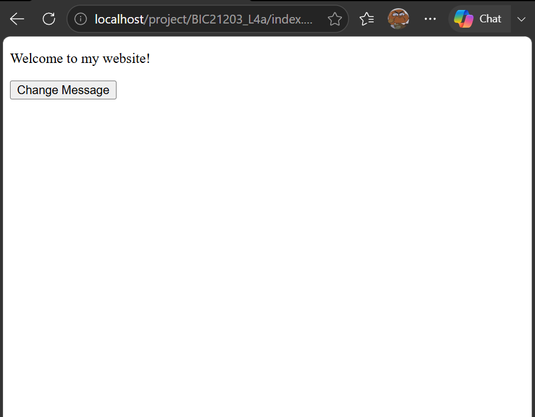
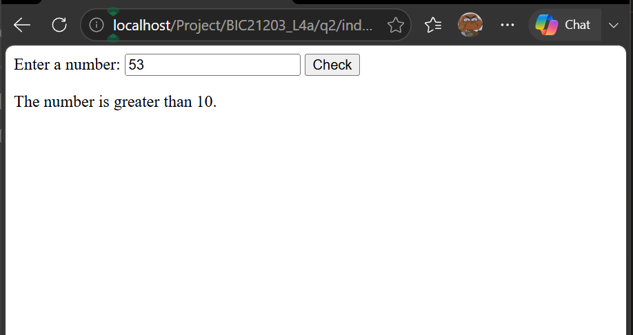
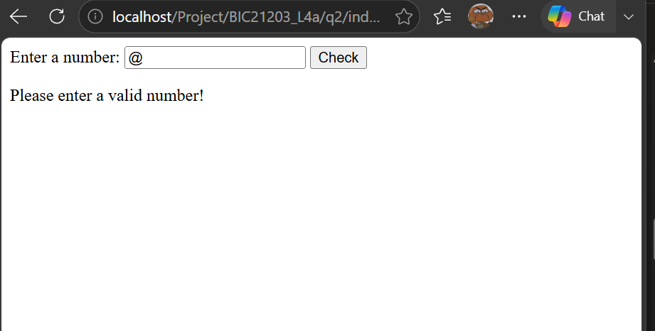

# BIC21203 Lab 4a JavaScript

Name: ANIS SOLEHAH BINTI JEFRI
MATRIX NUMBER: AI240100

## Question 1
Change paragraph text when button is clicked.

## Question 2
Validate user input and compare number with 10.

## Question 3
Generate numbered list using a for loop.

## How to Run
1. Open each question folder.
2. Run the HTML file in a browser.
3. Test the functionality.

