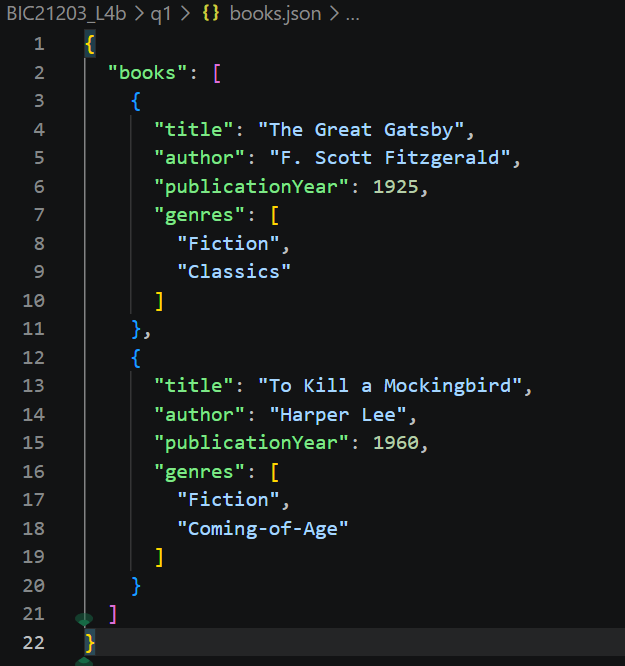

# BIC21203 Lab 4b JSON & QUERY

Name: ANIS SOLEHAH BINTI JEFRI
MATRIX NUMBER: AI240100

## Question 1
Created a JSON dataset containing information for two books.

## Question 2
Retrieved and displayed JSON data using the JavaScript fetch() API.
l4b.png)
l4b.png)

## Question 3
Used jQuery to perform DOM manipulation and event handling.
.png)
.png)

## How to Run
1. Open the project folder in Visual Studio Code.
2. Start a local server using Live Server or XAMPP.
3. Open books.html for Question 2.
4. Open jquery-dom.html for Question 3.
5. Verify that all outputs are displayed correctly.

